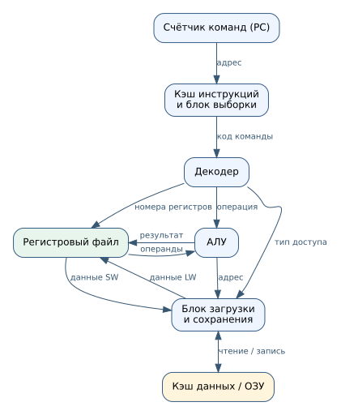
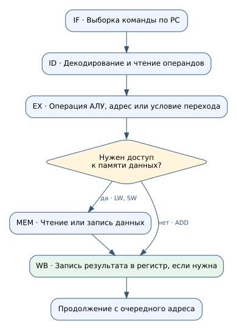

# Урок 4. Устройство процессора и цикл выполнения команд

Архитектура аппаратных средств · конспект

## Из чего состоит процессор

Процессор читает машинные команды, выполняет предписанные ими операции и обновляет состояние программы. Упрощённо в ядре можно выделить три группы блоков: блоки, которые получают и декодируют команды, регистры для операндов и исполнительные блоки. Арифметико-логическое устройство (АЛУ) выполняет целочисленное сложение, вычитание, логические операции и сравнения. Команды загрузки и сохранения обслуживает блок доступа к памяти.

| Блок | Что делает | Пример |
|---|---|---|
| Счётчик команд (PC) | Хранит адрес команды в архитектурной модели | После обычной 32-битной команды RV32I следующий адрес равен прежнему плюс 4 |
| Блок выборки | Получает код команды по адресу из PC | Читает команду из кэша инструкций |
| Декодер | Определяет операцию и её операнды по полям команды | Для ADD определяет два регистра-источника и один регистр назначения |
| Регистровый файл | Хранит доступные командам значения в ядре | Регистры x6 и x7 содержат слагаемые |
| АЛУ | Выполняет вычисления и сравнения | Складывает содержимое x6 и x7 |
| Блок доступа к памяти | Читает или записывает данные для команд загрузки и сохранения | LW читает слово, SW записывает слово |
| Кэши | Хранят копии недавно использованных участков памяти | Попадание в L1 сокращает время обращения за командами или данными |

*Рисунок 1. PC определяет адрес выборки. Декодер управляет исполнительными блоками, а регистры поставляют операнды и принимают результат.*

## Как выполняется команда

В учебной модели цикл состоит из выборки, декодирования, выполнения, доступа к памяти при необходимости и записи результата. Блоки современных процессоров могут работать параллельно, но модель помогает проследить путь одной команды.

*Рисунок 2. Команда ADD идёт по ветви без чтения или записи данных в памяти. Код самой команды при этом нужно выбрать.*

| Этап | Что происходит | Для `ADD x5, x6, x7` |
|---|---|---|
| Выборка (IF) | Код команды читается по адресу PC | При PC = 0x1000 читается команда по этому адресу |
| Декодирование (ID) | Определяются тип операции, источники и назначение | x6 = 7, x7 = 5, назначение — x5 |
| Выполнение (EX) | Исполнительный блок выполняет операцию или вычисляет адрес | АЛУ получает 7 + 5 = 12 |
| Доступ к данным (MEM) | Для загрузки читаются данные, для сохранения они записываются | Обращения к памяти данных нет |
| Запись результата (WB) | Если команда возвращает значение в регистр, оно записывается | x5 = 12 |

В базовом наборе RV32I эта команда занимает 4 байта. При последовательном выполнении следующим станет адрес 0x1004. Команды перехода могут изменить адрес. Например, условный переход после сравнения регистров выбирает между следующим адресом и адресом цели.

У разных команд меняется путь результата. Для `LW x5, 8(x6)` АЛУ вычисляет адрес `x6 + 8`. Блок доступа считывает 32-битное слово, после чего оно записывается в x5. Для `SW x5, 8(x6)` по вычисленному адресу записывается слово из x5, а регистр назначения отсутствует.

## Цикл команды, такты и конвейер

Цикл команды описывает, какие операции нужны для одной инструкции. Такт — интервал, задаваемый тактовой частотой. На конвейере несколько инструкций могут в один момент находиться на разных этапах: пока одна выполняется, следующая декодируется, а ещё одна выбирается. Поэтому число стадий нельзя напрямую приравнять к числу тактов на каждую команду в потоке.

Зависимость по данным, промах кэша и неверно предсказанный переход могут задержать выполнение. Например, если следующая команда читает x5 как раз после ADD, ядру нужно получить новое значение x5. Оно может передать его напрямую из исполнительного блока или подождать, пока значение будет доступно.

Источник: [RISC-V International, RV32I Base Integer Instruction Set, §1.1 и §1.4.2](https://docs.riscv.org/reference/isa/v20240411/unpriv/rv32.html).
