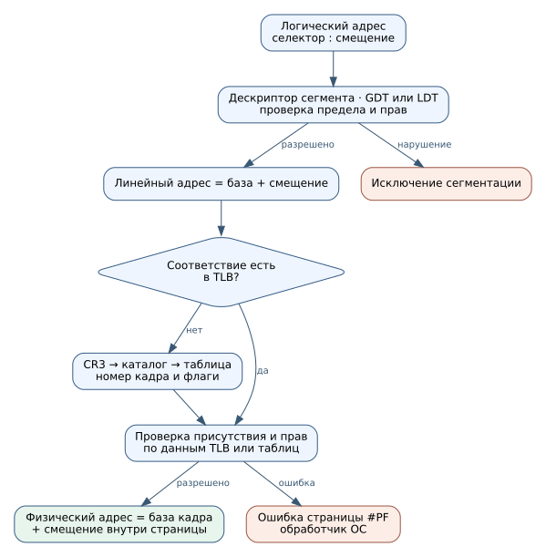

# Урок 6. Иерархия памяти и сегментно-страничная адресация

Архитектура аппаратных средств · конспект

## Иерархия памяти

Наиболее часто нужные данные разумно хранить ближе к ядру. Регистров и кэша мало, но доступ к ним быстрее. Оперативная память вмещает больше данных и служит основной рабочей памятью. SSD или HDD хранят файлы и при необходимости данные, выгруженные операционной системой из ОЗУ.

| Уровень | Назначение |
|---|---|
| Регистры | Операнды и результаты команд, непосредственно доступные ядру |
| Кэши L1, L2, L3 | Копии участков памяти. L1 обычно ближе всего к ядру, следующие уровни больше и медленнее |
| Оперативная память (ОЗУ) | Код и данные работающих программ, таблицы страниц, буферы ОС |
| SSD или HDD | Долговременные данные и, если настроено, область подкачки |

Кэш данных хранит копии данных, а TLB хранит недавние **соответствия страниц физическим кадрам** и связанные права доступа. Промах TLB ведёт к поиску в таблицах страниц. Если запись там есть и доступ разрешён, ошибки страницы не возникает.

## Из логического адреса в физический

В классическом 32-битном защищённом режиме IA-32 с включённой страничной адресацией процессор выполняет два преобразования. Сегментация переводит логический адрес в линейный, затем страничный механизм переводит линейный адрес в физический.

1. **Сегментация.** Логический адрес содержит селектор сегмента и смещение. Селектор указывает на дескриптор в глобальной (GDT) или локальной (LDT) таблице. Дескриптор задаёт базу, предел, тип и права доступа. Процессор проверяет допустимость операции и смещения. При разрешённом доступе он складывает базу сегмента со смещением.
2. **Страничная адресация.** Для учебного примера взяты страницы по 4 КиБ и классические двухуровневые таблицы без PAE. Биты 31–22 линейного адреса задают индекс каталога страниц, биты 21–12 — индекс в таблице, биты 11–0 — смещение внутри страницы. Регистр CR3 указывает на физическую базу каталога. Запись таблицы страниц указывает физический кадр и содержит флаги, в том числе присутствие и разрешения.
3. **Доступ.** Если есть подходящая запись TLB, процессор может обойтись без повторного чтения таблиц. После проверки прав к базе физического кадра прибавляется смещение внутри страницы. Программа может видеть сегмент или линейный диапазон как непрерывный, хотя физические кадры расположены раздельно.

*Рисунок 1. На схеме показаны два преобразования и разные причины остановки на каждом этапе.*

### Пример расчёта

Пусть база сегмента — `0x00400000`, смещение — `0x1234`. Доступ разрешён и смещение лежит в границах сегмента.

| Шаг | Результат |
|---|---|
| Сложить базу сегмента и смещение | `0x00400000 + 0x1234 = 0x00401234` |
| Извлечь индексы каталога и таблицы | `1` и `1` |
| Выделить смещение внутри страницы | `0x234` |
| Прочитать из записи номер кадра (для примера) | `0x2A`, его база — `0x0002A000` |
| Сложить базу кадра и смещение | `0x0002A000 + 0x234 = 0x0002A234` |

## Что происходит при ошибке страницы

Если запись страницы отсутствует или её права не разрешают доступ, процессор генерирует исключение **#PF**. Ядро ОС проверяет причину. При допустимом доступе оно может выделить физический кадр, восстановить страницу из файла или области подкачки, обработать запись с копированием (copy-on-write) и обновить таблицы. Затем команда может быть выполнена повторно. При недопустимом обращении ОС сообщает процессу об ошибке доступа. Превышение предела сегмента относится к сегментному этапу: оно может остановить обращение до проверки страниц.

В 64-битном режиме x86-64 для большинства обычных адресов сегменты имеют нулевую базу, а основную роль играет страничный механизм. Базы FS и GS могут использоваться, например, для данных отдельного потока.

## Как различать проблемы с памятью

| Наблюдение | Что проверить |
|---|---|
| Падает одна программа на одних и тех же входных данных | Воспроизводимость и сообщение об ошибке доступа. Возможен дефект программы |
| Система тормозит при заполненной ОЗУ, растут обращения к подкачке | Объём доступной памяти, процессы с большим рабочим набором, активность накопителя |
| Разные программы случайно завершаются с ошибкой, память выдаёт ошибки в тесте | Настройки памяти, журнал аппаратных ошибок и проверку модулей ОЗУ |
| Средства диагностики считают много ошибок страниц | Уточнить, требуют ли они чтения с диска. Обработка части событий происходит только в памяти |

Источник: [Intel Software Developer’s Manual, том 3A, глава 3 «Protected-Mode Memory Management» и глава о Paging](https://www.intel.com/content/www/us/en/developer/articles/technical/intel-sdm.html).
